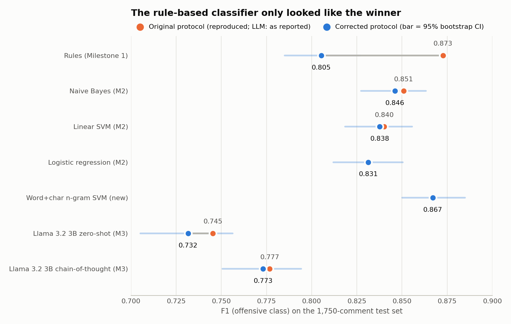

# HateBR: offensive-language detection in Brazilian Portuguese

**Rules vs. classical ML vs. a CNN vs. LLM prompting, on the same 1,750-comment test set — re-audited.**

Coursework for *Natural Language Processing* (BSc in AI & Data Science, University of Coimbra, 2025/26), by **Lorran Deiró** and **Pedro Sandoval**. The task: classify Instagram comments on posts by Brazilian politicians as offensive or not ([HateBR](https://aclanthology.org/2022.lrec-1.777/), 7,000 comments, 50/50 balanced, labelled by three annotators).

The project had three milestones: a rule-based classifier, ML models, and prompt engineering with an open LLM of at most 8B parameters. The original code and reports are kept unchanged in [`archive/`](archive/). This repository is the version I rebuilt after the course, when I re-read the code and found that **the headline conclusion of the final report did not hold**.



## What changed, in one paragraph

The final report concluded that the hand-built rule system was the best approach (F1 0.873, "better than ML"). But its lexicon of 493 "offensive words" was mined from all 7,000 comments, labels included, and then scored on those same 7,000 comments. Rebuilt from the 5,250 training comments only and scored on the 1,750 held-out comments, the rule system drops to **F1 0.805** and falls behind every ML model we trained. 148 of the 493 words could only be learned by looking at the test set. The CNN had a milder version of the same problem, and two of the three LLM prompts did not do what the report said they did. Once they did, few-shot got much *worse*, not better.

## Results (held-out test set, n = 1,750)

F1 is for the offensive class. Brackets are 95% bootstrap confidence intervals (2,000 resamples), so differences of ~2 points between models are within noise.

| Approach | As reported | Corrected | What was wrong |
|---|---|---|---|
| Rule-based (13 weighted rules, n-gram lexicon, NER, sentiment) | 0.873 | **0.805** [0.785, 0.827] | Lexicon mined from the full dataset, then evaluated on the same data |
| Naive Bayes, TF-IDF | 0.850 | **0.846** [0.827, 0.863] | TF-IDF fitted before the split (small effect) |
| Linear SVM, TF-IDF | 0.839 | **0.838** [0.819, 0.856] | same |
| Logistic regression, TF-IDF | 0.832 | **0.831** [0.812, 0.850] | same |
| CNN (Conv1D over learned embeddings) | 0.877 (1 run) | **0.843 ± 0.006** (5 seeds) | Keras tokenizer fitted on all 7,000 texts; test set used as `validation_data` |
| **Word + char n-gram linear SVM** *(new)* | — | **0.867** [0.850, 0.885] | New baseline, C tuned by 5-fold CV on train only |
| Llama 3.2 3B, zero-shot | 0.745 | **0.732** [0.705, 0.756] | Refusals silently scored as "not offensive" (only 6 here, so a small effect) |
| Llama 3.2 3B, few-shot | 0.736 | **0.290** [0.254, 0.325] | The 16 examples were selected but **never inserted in the prompt**; with them in, the model answers "0" to 91% of comments |
| Llama 3.2 3B, chain-of-thought | 0.777 | **0.773** [0.751, 0.794] | Output capped at 10 tokens, so no reasoning could be generated; 126 abstentions now counted as errors |

"As reported" numbers are reproduced by the scripts here to within 0.1 point (rules: 0.8727, exactly as in the Milestone 1 output). The CNN under its original protocol averages 0.886 ± 0.004 over 5 seeds.

### Findings

1. **The rules only won because they had seen the answers.** A lexicon built by frequency ratio memorises words that happen to appear only in offensive comments in this sample: names (`Macron`, `Moraes`), function words (`MAIS`, `EU`, `quatro`), and one-off insults. Evaluated in-sample, that looks like knowledge; out of sample it is noise. With a clean split, every ML model beats the rules.
2. **The best honest model is the simplest robust one.** A linear SVM over word 1–2-grams plus character 2–5-grams (F1 0.867) handles `LIXOOO`, `vagabu*da` and missing accents better than word-level TF-IDF, and matches the (leaky) CNN.
3. **The CNN's 4.5-point advantage came from its tokenizer.** Changing *only* where the tokenizer is fitted (all data → train only, same 10 epochs) takes it from 0.886 to 0.840. The model leans heavily on the `<OOV>` token: replacing test-only words with `<OOV>` at inference collapses the original model to F1 ≈ 0.55. Which words end up in `<OOV>` was decided with test-set counts. Dropping the `<OOV>` token entirely does not recover the gap (0.841).
4. **Random splits flatter every model.** Comments under the same Instagram post share topic and vocabulary. With 5-fold CV grouped by post (no post in both train and test), F1 falls from 0.839 to 0.792 for Naive Bayes and from 0.877 to 0.836 for the word+char SVM, with much larger fold-to-fold variance (± 0.05–0.07). The random-split numbers above are best read as upper bounds for new posts.
5. **The LLM comparison was not a fair test of prompting, and fixing it did not help the LLM.** In the original code the three strategies were three wordings of a zero-shot prompt: the "few-shot" prompt never contained its examples and the "CoT" prompt could not generate more than 10 tokens. With the fixes (and prompts chosen on a validation sample, see below):
   - **Zero-shot** barely moves (0.745 → 0.732, inside the confidence interval). The original prompt was sound; scoring refusals as errors instead of "0" changes F1 by less than 0.005 here, so the gap most likely comes from re-running a year later (Ollama and model builds have changed), not from the fix.
   - **Few-shot collapses** (→ 0.290). With 16 real examples in the prompt, Llama 3.2 3B answers "0" to 91% of test comments. Both wordings I tried did this on validation (F1 0.06 and 0.39). My best guess is recency bias (the last example before the target is always a "0"), but I did not tune further, because that would mean searching prompts until a number looks good.
   - **Chain-of-thought** is the best prompt (0.773), but 64 of 1,750 comments get a refusal ("Desculpe, não posso…"), 58 of them offensive, and another 62 answers never reach a final label. If a refusal is read as "offensive", F1 rises to 0.813, which is still below every ML model trained on the data.
   - **Prompt wording matters more than the strategy.** My first rewrite of the zero-shot prompt added one clause to the definition of class 0 ("crítica sem insulto, elogio"). Recall dropped from 65% to 5% (F1 0.102). It stays in the results as a negative example.

## LLM protocol

Prompts are selected on a **300-comment validation sample drawn from the training split** (balanced, excluding the 16 few-shot examples). Only the best prompt of each family by validation F1 is run on the 1,750 test comments. Llama 3.2 3B (Q4, via Ollama), temperature 0, greedy decoding, seed 42.

| Variant | What it is | Val F1 | Test F1 |
|---|---|---|---|
| `zs-original` | Milestone 3 zero-shot prompt, verbatim | **0.767** | **0.732** |
| `zs-rewrite` | My rewrite (one extra clause on class 0) | 0.213 | 0.102 ¹ |
| `fs-original` | Milestone 3 wording + the 16 examples | 0.065 | — |
| `fs-rewrite` | Rewrite wording + the 16 examples | **0.387** | **0.290** ¹ |
| `cot-256` | Checklist + `RESPOSTA:` line, ≤256 tokens | 0.768 | 0.772 ¹ |
| `cot-512` | Same, ≤512 tokens | **0.797** | **0.773** |

¹ Run on test before the validation protocol existed; reported for completeness, not used to pick anything.

Every model answer is kept in `results/llm_raw_*.jsonl`. `python scripts/score_llm.py` re-scores all of them without calling the model, and each `results/llm_*.json` also reports the F1 you get if refusals count as "offensive".

```bash
ollama pull llama3.2:3b
python scripts/run_llm.py --strategy zs-original --on val     # ~12 min on a laptop GPU
python scripts/run_llm.py --strategy cot-512 --on test        # ~2.5 h
```

## Reproduce

```bash
pip install -r requirements.txt
python -m spacy download pt_core_news_sm
python -c "import nltk; nltk.download('punkt'); nltk.download('punkt_tab'); nltk.download('stopwords')"

python scripts/run_rules.py     # Milestone 1: original vs corrected protocol   (~1 min)
python scripts/run_ml.py        # Milestone 2: TF-IDF models, word+char SVM, grouped CV (~1 min)
python scripts/run_cnn.py       # Milestone 2: CNN, 4 protocols x 5 seeds (~6 min on CPU)
python scripts/make_figure.py   # results/figures/
python scripts/score_llm.py     # LLM metrics from the cached answers (model runs: see above)
pytest -q                       # guards against the mistakes above
```

Every approach uses the same split: `train_test_split(test_size=0.25, random_state=42, stratify=label)` → 5,250 / 1,750, identical to the one the original Milestone 2 and 3 code used, so old and new numbers are on the same 1,750 comments.

## Layout

```
src/hatebr/     data.py (single fixed split) · rules.py · ml.py · llm.py · metrics.py (bootstrap CI)
scripts/        one script per milestone, score_llm.py (re-score cached LLM answers), figure
results/        JSON metrics and figures produced by the scripts
tests/          split is disjoint; lexicon ignores test data; few-shot prompt contains its examples;
                prompt selection never sees test; refusals and truncated answers are not "0"
archive/        original code and reports for each milestone, unchanged (Portuguese)
data/           HateBR.csv (Apache-2.0, see data/README.md)
```

## Why metric choices matter here

F1 on the offensive class is the main metric because the classes are balanced and both error types have a cost: false positives are unjustified moderation of legitimate (often harsh) political criticism; false negatives leave abuse up. Precision and recall are reported separately because the approaches trade them very differently (the original CoT prompt reached 94% recall at 66% precision).

## Credits

- Dataset: Vargas, F., Carvalho, I., Góes, F. R., Pardo, T. A. S., Benevenuto, F. (2022). *HateBR: A Large Expert Annotated Corpus of Brazilian Instagram Comments for Offensive Language and Hate Speech Detection.* LREC 2022.
- Course: *Processamento de Linguagem Natural*, DEI – University of Coimbra (Isabel Carvalho, Patrícia Ferreira, Hugo Gonçalo Oliveira).
- Original milestones: Lorran Deiró and Pedro Sandoval. Post-course audit and rebuild: Lorran Deiró, with AI coding assistance, reviewed and run by me.

Code: MIT. The dataset keeps its own licence (Apache-2.0). The data contains offensive language.
